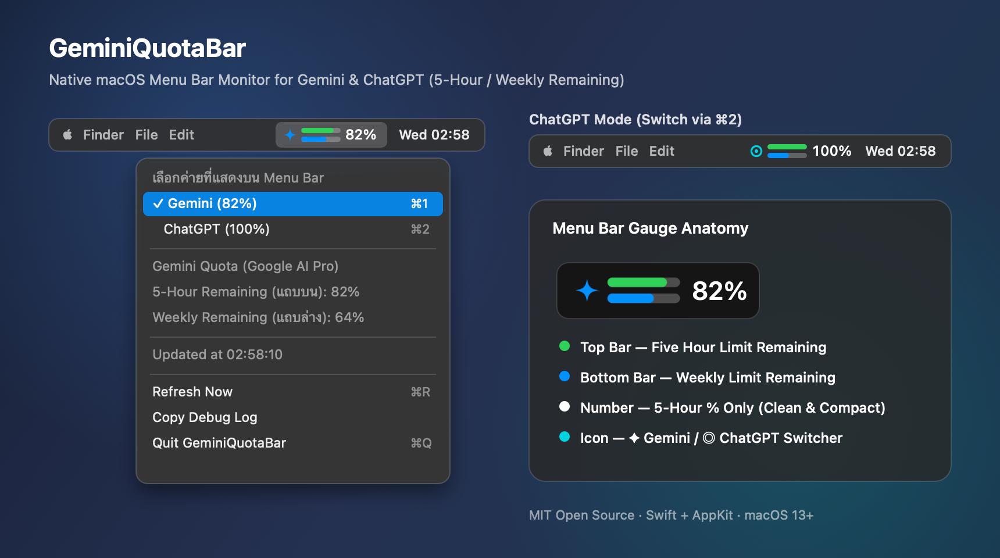

# GeminiQuotaBar

A lightweight, native macOS **menu-bar-only** app built with Swift & AppKit that displays your **5-Hour Limit Remaining** and **Weekly Limit Remaining** for both **Gemini (Antigravity)** and **ChatGPT (Codex)** — as **2 stacked progress bars** with **only the 5-hour percentage** shown right in the macOS menu bar.

> แอป macOS Menu Bar น้ำหนักเบา (ไม่แสดงใน Dock) สำหรับดูโควต้าคงเหลือ **5-Hour / Weekly** ของทั้ง **Gemini (Antigravity)** และ **ChatGPT** แบบ 2 แถบ Progress Bar ซ้อนกัน พร้อมแสดงตัวเลข `%` เฉพาะ 5h และสลับค่ายได้ทันทีจาก Menu Bar



---

## Features

- **Menu Bar Only (`LSUIElement = true`)** — No Dock icon, no main window, ultra-low memory footprint.
- **2 Stacked Progress Bars + 5h % Only**:
  - **Top bar**: 5-Hour Limit Remaining (Green >50%, Orange 20–50%, Red <20%)
  - **Bottom bar**: Weekly Limit Remaining (Blue >50%, Orange 20–50%, Red <20%)
  - **Percentage text**: Shows only the **5-hour remaining %** next to the bars.
- **Instant Provider Switcher (`⌘1` / `⌘2`)**:
  - Switch between **Gemini** (`✦`) and **ChatGPT** (`◎`) directly from the menu bar dropdown.
  - Fetches both providers in parallel and remembers your last selected provider.
- **Detailed Dropdown**: Click the menu bar item to view exact 5-hour & weekly remaining percentages, plan tier, reset countdowns, and last updated timestamp.
- **Demo Mode (`--demo`)**: Preview the menu bar UI without live accounts.

---

## Requirements

- **macOS 13.0+** (Ventura or newer)
- **Xcode Command Line Tools** (`swiftc`) to build from source
- **For Gemini**: [Antigravity CLI (`agy`)](https://antigravity.google) installed and signed in (`~/.local/bin/agy`)
- **For ChatGPT**: OpenAI Codex CLI signed in (`codex login`, creating `~/.codex/auth.json`)

---

## Build & Run

```bash
git clone https://github.com/itchampclub/gemini-quota-bar.git
cd gemini-quota-bar

# Build GeminiQuotaBar.app
./scripts/build_app.sh

# Launch the menu bar app
open GeminiQuotaBar.app
```

To install permanently, drag `GeminiQuotaBar.app` into `/Applications`.

### Preview with Demo Data

```bash
./GeminiQuotaBar.app/Contents/MacOS/GeminiQuotaBar --demo
```

---

## Keyboard Shortcuts (in Dropdown Menu)

| Shortcut | Action |
| :--- | :--- |
| `⌘1` | Switch menu bar display to **Gemini** |
| `⌘2` | Switch menu bar display to **ChatGPT** |
| `⌘R` | Refresh quotas immediately |
| `⌘Q` | Quit GeminiQuotaBar |

---

## How It Works & Privacy

- **Gemini (Antigravity)**: Runs your locally installed `agy` CLI in a background pseudo-terminal (`openpty`), invokes the built-in `/usage` command, parses the 5-hour & weekly remaining percentages, and exits cleanly.
- **ChatGPT (OpenAI / Codex)**: Reads your local OAuth session from `~/.codex/auth.json` (or `$CODEX_HOME/auth.json`) and queries `https://chatgpt.com/backend-api/wham/usage` directly from your Mac.
- **100% Local**: No telemetry, no third-party servers, and no credentials ever leave your machine. The built-in `Copy Debug Log` action masks tokens and never copies secrets.

---

## Project Structure

```text
.
├── Package.swift
├── scripts/
│   └── build_app.sh                     # Compiles & packages GeminiQuotaBar.app
├── docs/
│   └── images/
│       └── menubar-preview.png          # Example usage screenshot
└── Sources/GeminiQuotaBar/
    ├── main.swift                       # Accessory-only NSApplication entry point
    ├── AppDelegate.swift                # NSStatusItem, dropdown menu, refresh timer
    ├── MenuBarRenderer.swift            # Retina 2-bar gauge & provider micro-icons
    ├── QuotaModels.swift                # Provider models & JSON parsers
    ├── QuotaService.swift               # Gemini quota via official `agy /usage` PTY
    └── ChatGPTQuotaService.swift        # ChatGPT quota via Codex OAuth wham/usage
```

---

## License

Released under the [MIT License](LICENSE).
